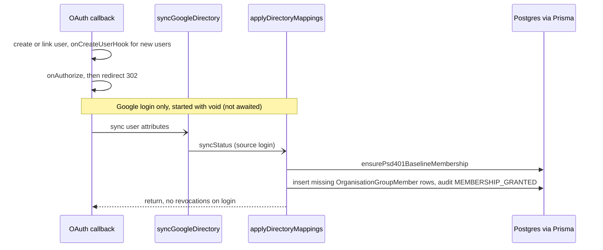
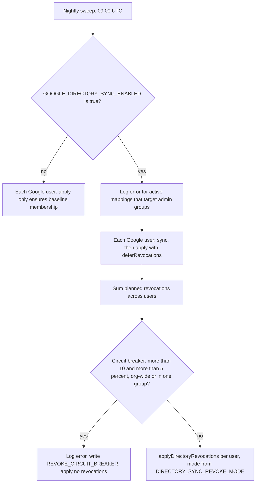

# Google SSO, auto-join, and directory sync

## Auto-join on sign-up

The PSD401 constants (`PSD401_ORG_ID = 'org_psd401district'`,
`PSD401_BASELINE_GROUP_IDS`, `PSD401_DEFAULT_TEAM_GROUP_ID`) live in
[`packages/lib/constants/psd401.ts`](../../packages/lib/constants/psd401.ts).
[`create-user.ts`](../../packages/lib/server-only/user/create-user.ts)'s
`onCreateUserHook(user)` calls `ensurePsd401BaselineMembership(user.id)` in
[`psd401-membership.ts`](../../packages/lib/server-only/directory-sync/psd401-membership.ts).
That helper guarantees that the user holds both baseline groups on at
least one PSD401 `OrganisationMember` row:

- **No PSD401 row yet**: it creates one `OrganisationMember` with two
  nested `OrganisationGroupMember` rows, one for the org-wide member group
  and one for the Default team's member group. If a concurrent caller (a
  second OAuth callback or the sweep) inserts the row first and the write
  fails with Prisma `P2002`, the helper re-reads once and tops up the row
  that caller created.
- **Rows exist**: it adds any baseline group no row holds yet to the
  primary row, chosen by `pickPrimaryMemberRow` (the row already holding
  the Default group, otherwise the oldest row). Writes use
  `skipDuplicates`.

Both baseline groups must land together. If only the org-level membership
exists, the user can log in but has no team context to send documents
from.

The helper is also the first step of every directory-sync apply
(`applyDirectoryMappings`), so baseline membership is restored on login and
in the nightly sweep even when `GOOGLE_DIRECTORY_SYNC_ENABLED` is off.

Earlier, a hand-installed Postgres trigger (`trg_auto_add_psd401` on
`Account`) inserted PSD401 member rows holding only the org group. The
migration
[`20260923000000_drop_psd401_auto_add_trigger/migration.sql`](../../packages/prisma/migrations/20260923000000_drop_psd401_auto_add_trigger/migration.sql)
drops that trigger and its function (`IF EXISTS`, so it is a no-op where
the trigger never existed). Application code is now the only auto-join
path. The migration's comment covers the one known failure: if the
function is owned by another role, the drop fails with "must be owner of
function" and needs the owner changed first.

Sign-up is restricted by allowed email domain:
`getAllowedSignupDomains()` in
[`packages/lib/constants/auth.ts`](../../packages/lib/constants/auth.ts)
reads `NEXT_PRIVATE_ALLOWED_SIGNUP_DOMAINS` (comma-separated, lowercased,
trimmed); an empty value allows all domains. Production sets this to
`psd401.net`.

## Google Directory Sync

A nightly job re-syncs each user's Google Workspace attributes (`department`,
`orgUnitPath`, `googleGroups`) and, separately from the sync itself, an
apply engine grants org-group membership based on admin-managed mapping
rules. The attribute sync and mapping evaluation are gated behind
`GOOGLE_DIRECTORY_SYNC_ENABLED=true`; baseline membership is not (see
[Auto-join on sign-up](#auto-join-on-sign-up)).

Login and the nightly sweep run the same apply engine with different
rules. Login only grants. Sign-in does not wait for the directory chain:

*Login chain: the directory grant runs after the user is already signed in.
Its failures are logged as `[directory-sync] Login chain failed`.*

*Sweep flow: revocations are planned first and applied only after the
breaker check passes.*

- **Sweep job**: [`packages/lib/jobs/definitions/internal/directory-sync-sweep.ts`](../../packages/lib/jobs/definitions/internal/directory-sync-sweep.ts),
  cron `0 9 * * *` (09:00 UTC, ~1am Pacific), handler in
  `directory-sync-sweep.handler.ts`.
- **Apply engine**: [`packages/lib/server-only/directory-sync/apply-directory-mappings.ts`](../../packages/lib/server-only/directory-sync/apply-directory-mappings.ts) —
  reads a user's synced `department`/`orgUnitPath`/`googleGroups` and all
  `active: true` `DirectoryGroupMapping` rows, matches via
  [`mapping-matching.ts`](../../packages/lib/server-only/directory-sync/mapping-matching.ts),
  and inserts any missing `OrganisationGroupMember` rows. Each grant writes a
  `DirectorySyncAuditLog` row (`type: MEMBERSHIP_GRANTED`). Login only grants.
  The nightly sweep also plans revocations: rows in groups an active mapping
  targets that the user no longer matches. `DIRECTORY_SYNC_REVOKE_MODE`
  (`enforce` / `log` / `off`, default `log`) decides whether they are deleted
  or only audited as `MEMBERSHIP_REVOKE_DRY_RUN`. The sweep's circuit breaker
  skips every revocation (one `REVOKE_CIRCUIT_BREAKER` row) when planned
  revocations exceed both 10 and 5%, org-wide or within one group.
- **Admin groups are off limits**: a mapping whose target group has
  organisation role ADMIN or any `TeamGroup.teamRole` ADMIN never grants or
  revokes, and the admin create/update routes reject it
  ([`assert-mapping-target-allowed.ts`](../../packages/lib/server-only/directory-sync/assert-mapping-target-allowed.ts)).
  The reverse also holds: a group an active mapping targets cannot be given
  organisation or team ADMIN (deactivate the mapping first), and the sweep logs
  an error naming any active mapping it ignores for this reason.
- **Matching rules** (`DirectoryMappingSourceField` enum:
  `GROUP | DEPARTMENT | ORG_UNIT`): `GROUP` does a case-insensitive match
  against the user's Google group list; `DEPARTMENT` is an exact string
  match; `ORG_UNIT` is a prefix/path match on the normalized
  `orgUnitPath` (`/` matches everyone).

### What a mapping actually grants — correcting a common shorthand

A `DirectoryGroupMapping` row (schema.prisma, `DirectoryGroupMapping`
model) has FK `organisationGroupId → OrganisationGroup`, **not** a direct
FK to `Team`. A mapping grants membership in an `OrganisationGroup`; that
group only translates into team access if it's separately linked to a
team via a `TeamGroup` row (`organisationGroupId` + `teamId` +
`teamRole`). So "map a Google attribute to a team" is a two-step
relationship in the schema: attribute → `OrganisationGroup` (via the
mapping) → `Team` (via a pre-existing `TeamGroup` link) — not a mapping
directly onto a team. This matters when troubleshooting: creating a
mapping to a group that isn't linked to any team via `TeamGroup` grants
org membership but no team/document access.

### Admin UI

`admin.directoryMappings` tRPC namespace: the handlers live in
[`packages/trpc/server/admin-router/`](../../packages/trpc/server/admin-router/router.ts)
as `create-directory-mapping.ts`, `update-directory-mapping.ts`,
`delete-directory-mapping.ts`, `find-directory-mappings.ts`, and
`list-directory-mapping-groups.ts` (group picker). The lib functions in
`packages/lib/server-only/directory-sync/create-directory-mapping.ts` and
`update-directory-mapping.ts` call `assertMappingTargetAllowed` before
writing (update checks only when the resulting mapping is active). UI route:
[`apps/remix/app/routes/_authenticated+/admin+/directory-mappings.tsx`](../../apps/remix/app/routes/_authenticated+/admin+/directory-mappings.tsx).

### Schema

Migration
[`packages/prisma/migrations/20260812000000_add_directory_group_mapping/migration.sql`](../../packages/prisma/migrations/20260812000000_add_directory_group_mapping/migration.sql)
added: enum `DirectoryMappingSourceField` (`GROUP`, `DEPARTMENT`,
`ORG_UNIT`); table `DirectoryGroupMapping` (`sourceField`, `sourceValue`,
`organisationGroupId`, `active`, unique on
`(sourceField, sourceValue, organisationGroupId)`); table
`DirectorySyncAuditLog` (`type`, `data` JSON, optional `userId`/`name`/
`email`, indexed on `createdAt`/`type`).

Design docs: [`docs/superpowers/plans/2026-05-19-google-directory-sync.md`](../../docs/superpowers/plans/2026-05-19-google-directory-sync.md)
(Phase 1: sync), [`docs/superpowers/plans/2026-08-12-directory-sync-phase2.md`](../../docs/superpowers/plans/2026-08-12-directory-sync-phase2.md)
(Phase 2: mapping + apply engine. Its additive-only invariant was replaced by sweep revocation in PR #172).

## Invariants and focused tests

| Invariant | Narrowest check |
|---|---|
| Login only grants; it never revokes or writes revocation audit rows, in any `DIRECTORY_SYNC_REVOKE_MODE`. | `apply-directory-mappings.test.ts`: "login never revokes or writes revocation audit rows (… mode), but still grants" |
| Baseline groups are never revoked, and groups no active mapping targets are never touched. | `apply-directory-mappings.test.ts`: "never revokes a baseline group…", "never touches a group that no active mapping targets" |
| Mappings whose target group grants ADMIN are ignored by the planner and never grant. | `plan-directory-membership.test.ts`: "never grants a group that grants admin…"; `apply-directory-mappings.test.ts`: "does not grant a matched mapping whose target group grants admin" |
| Create/update of a mapping rejects an ADMIN target; a mapped group cannot be given ADMIN. | `assert-mapping-target-allowed.test.ts`: "rejects granting ADMIN to a group an active mapping targets" |
| Sweep revocations are deferred and applied only when the circuit breaker passes. | `directory-sync-sweep.handler.test.ts`: "applies deferred revocations per user when they are at most 5%…", "applies no revocations, logs an error…" |
| Baseline membership is ensured even when sync is disabled, and concurrent creates are topped up. | `directory-sync-sweep.handler.test.ts`: "still walks every scoped user so baseline membership is ensured…"; `psd401-membership.test.ts`: "tops up the row a concurrent caller created…"; `user/create-user.test.ts`: "adds the missing Default team group to a member already created by the DB trigger" |

Run the focused suite from `packages/lib` with
`npx vitest run --project unit directory-sync create-user --reporter=dot`;
the `dot` reporter keeps passing output short, and failing tests still
report their errors. The vitest `unit` project is defined in
[`packages/lib/vitest.config.ts`](../../packages/lib/vitest.config.ts).

## Change guidance

- **Start at the planner and the apply engine.** Grant and revoke decisions
  live in [`plan-directory-membership.ts`](../../packages/lib/server-only/directory-sync/plan-directory-membership.ts)
  (pure, no Prisma). Persistence, audit rows, and the login/sweep split live
  in [`apply-directory-mappings.ts`](../../packages/lib/server-only/directory-sync/apply-directory-mappings.ts).
  Changing a grant rule without updating the matching tests breaks the
  admin-target invariants above.
- **Revocation changes belong in the sweep.** Do not add revocations to the
  login path. The login early return is the guard that keeps a bad mapping
  from removing access at sign-in.
- **Mapping writes go through the guard.** A new write path that targets
  `OrganisationGroup` or sets ADMIN must call `assertMappingTargetAllowed` or
  `assertGroupsNotDirectoryMapped`; the org/team group routers already do.
  See [teams-and-access.md](teams-and-access.md) for the group and role model.
- **Keep baseline membership separate.** `ensurePsd401BaselineMembership` is
  not gated by the feature flag. Do not move it behind
  `GOOGLE_DIRECTORY_SYNC_ENABLED`.

## Source references

- [`packages/lib/server-only/user/create-user.ts`](../../packages/lib/server-only/user/create-user.ts) (`onCreateUserHook`)
- [`packages/lib/server-only/directory-sync/psd401-membership.ts`](../../packages/lib/server-only/directory-sync/psd401-membership.ts) (baseline ensure)
- [`packages/lib/server-only/directory-sync/apply-directory-mappings.ts`](../../packages/lib/server-only/directory-sync/apply-directory-mappings.ts) (apply engine, revoke mode)
- [`packages/lib/server-only/directory-sync/plan-directory-membership.ts`](../../packages/lib/server-only/directory-sync/plan-directory-membership.ts) (planner, breaker thresholds)
- [`packages/lib/server-only/directory-sync/assert-mapping-target-allowed.ts`](../../packages/lib/server-only/directory-sync/assert-mapping-target-allowed.ts) (admin-target guards)
- [`packages/lib/server-only/directory-sync/mapping-matching.ts`](../../packages/lib/server-only/directory-sync/mapping-matching.ts) (rule matching)
- [`packages/lib/jobs/definitions/internal/directory-sync-sweep.ts`](../../packages/lib/jobs/definitions/internal/directory-sync-sweep.ts) and [`directory-sync-sweep.handler.ts`](../../packages/lib/jobs/definitions/internal/directory-sync-sweep.handler.ts)
- [`packages/auth/server/lib/utils/handle-oauth-callback-url.ts`](../../packages/auth/server/lib/utils/handle-oauth-callback-url.ts) (login chain)
- [`packages/trpc/server/admin-router/`](../../packages/trpc/server/admin-router/router.ts) (`*directory-mapping*.ts`)
