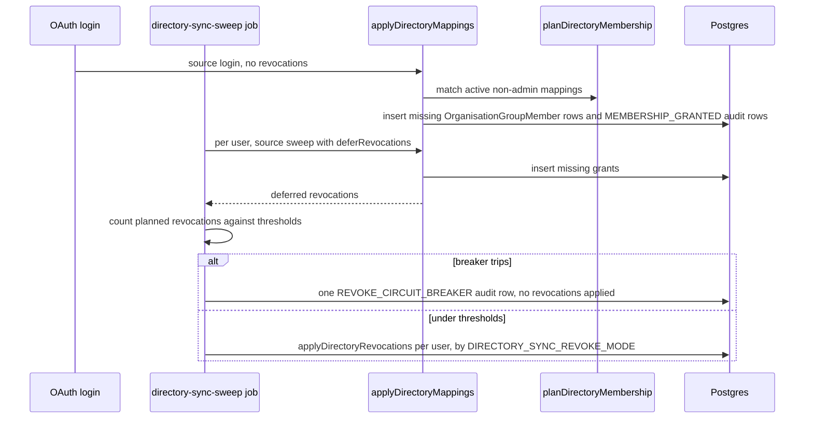

# Google SSO, auto-join, and directory sync

## Auto-join on sign-up

[`packages/lib/server-only/user/create-user.ts`](../../packages/lib/server-only/user/create-user.ts)
hardcodes three PSD401 constants: `PSD401_ORG_ID = 'org_psd401district'`,
`PSD401_MEMBER_GROUP_ID = 'org_group_psd401_member'`,
`PSD401_DEFAULT_TEAM_GROUP_ID = 'org_group_default_member'`.
`onCreateUserHook(user)` calls `addUserToPsd401Org(user.id)`, which:

- no-ops if the user already has an `OrganisationMember` row for
  `org_psd401district`;
- otherwise creates one `OrganisationMember` row with two nested
  `OrganisationGroupMember` creates: one for `org_group_psd401_member`
  (the org-wide member group) and one for `org_group_default_member` (the
  Default team's member group).

Both membership rows land on the *same* new user in the same hook call —
this is what lets a fresh Google sign-in both join the PSD401 org and get
into the Default team's document context in one step. If a directory-sync
or manual-provisioning path creates only the org-level membership without
the team-level one, the user can log in but has no team context to send
documents from (see `reference_known_issues` for the recurring
`org_member_auto_*` variant of this gap).

Sign-up is restricted by allowed email domain:
`getAllowedSignupDomains()` in
[`packages/lib/constants/auth.ts`](../../packages/lib/constants/auth.ts)
reads `NEXT_PRIVATE_ALLOWED_SIGNUP_DOMAINS` (comma-separated, lowercased,
trimmed); an empty value allows all domains. Production sets this to
`psd401.net`.

## Google Directory Sync

A nightly job re-syncs each user's Google Workspace attributes (`department`,
`orgUnitPath`, `googleGroups`) and, separately from the sync itself, an
apply engine grants org-group membership based on admin-managed mapping
rules — both gated behind `GOOGLE_DIRECTORY_SYNC_ENABLED=true`.

- **Sweep job**: [`packages/lib/jobs/definitions/internal/directory-sync-sweep.ts`](../../packages/lib/jobs/definitions/internal/directory-sync-sweep.ts),
  cron `0 9 * * *` (09:00 UTC, ~1am Pacific), handler in
  `directory-sync-sweep.handler.ts`. It runs on the in-house job runner
  described in [jobs-and-pdf-pipeline.md](../architecture/jobs-and-pdf-pipeline.md#job-system).
- **Apply engine**: [`packages/lib/server-only/directory-sync/apply-directory-mappings.ts`](../../packages/lib/server-only/directory-sync/apply-directory-mappings.ts) —
  reads a user's synced `department`/`orgUnitPath`/`googleGroups` and all
  `active: true` `DirectoryGroupMapping` rows, matches via
  [`mapping-matching.ts`](../../packages/lib/server-only/directory-sync/mapping-matching.ts),
  and inserts any missing `OrganisationGroupMember` rows. Each grant writes a
  `DirectorySyncAuditLog` row (`type: MEMBERSHIP_GRANTED`). Login only grants.
  The nightly sweep also plans revocations: rows in groups an active mapping
  targets that the user no longer matches. `DIRECTORY_SYNC_REVOKE_MODE`
  (`enforce` / `log` / `off`, default `log`) decides whether they are deleted
  or only audited as `MEMBERSHIP_REVOKE_DRY_RUN`. The sweep's circuit breaker
  skips every revocation (one `REVOKE_CIRCUIT_BREAKER` row) when planned
  revocations exceed both 10 and 5%, org-wide or within one group.
- **Admin groups are off limits**: a mapping whose target group has
  organisation role ADMIN or any `TeamGroup.teamRole` ADMIN never grants or
  revokes, and the admin create/update routes reject it
  ([`assert-mapping-target-allowed.ts`](../../packages/lib/server-only/directory-sync/assert-mapping-target-allowed.ts)).
  The reverse also holds: a group an active mapping targets cannot be given
  organisation or team ADMIN (deactivate the mapping first), and the sweep logs
  an error naming any active mapping it ignores for this reason.
- **Matching rules** (`DirectoryMappingSourceField` enum:
  `GROUP | DEPARTMENT | ORG_UNIT`): `GROUP` does a case-insensitive match
  against the user's Google group list; `DEPARTMENT` is an exact string
  match; `ORG_UNIT` is a prefix/path match on the normalized
  `orgUnitPath` (`/` matches everyone).

### Login versus sweep

Both paths call the same `applyDirectoryMappings(userId, source, syncStatus, options)`
engine, but they differ in when revocations run. A login only grants. The nightly
sweep syncs each enabled Google-linked user, then defers revocations so it can
apply the circuit breaker across all users before deleting anything.

Grants still apply when the breaker trips. Only revocations are skipped.

### Change navigation

- Matching and revocation rules: [`plan-directory-membership.ts`](../../packages/lib/server-only/directory-sync/plan-directory-membership.ts)
  (`planDirectoryMembership`, `groupGrantsAdmin`, `exceedsRevokeCircuitBreaker`,
  `findGroupsExceedingRevokeCircuitBreaker`). It is pure and has no Prisma calls.
- Writes, audit rows, and revoke mode: [`apply-directory-mappings.ts`](../../packages/lib/server-only/directory-sync/apply-directory-mappings.ts)
  (`applyDirectoryMappings`, `applyDirectoryRevocations`, `getDirectorySyncRevokeMode`).
- Batch orchestration, breaker wiring, and the ignored-admin-mapping log:
  [`directory-sync-sweep.handler.ts`](../../packages/lib/jobs/definitions/internal/directory-sync-sweep.handler.ts) (`run`).
- ADMIN guards: [`assert-mapping-target-allowed.ts`](../../packages/lib/server-only/directory-sync/assert-mapping-target-allowed.ts)
  (`ADMIN_GRANTING_GROUP_WHERE`, `assertMappingTargetAllowed`, `assertGroupsNotDirectoryMapped`).
  Team and organisation group routes call `assertGroupsNotDirectoryMapped`; see
  [teams-and-access.md](teams-and-access.md#admin-grants-on-directory-mapped-groups).

Invariants to keep:

- Login never revokes, and a sweep that trips the breaker never revokes.
- Mappings whose target group grants ADMIN are never granted and never make a group managed.
- A group with an active mapping cannot gain organisation or team ADMIN until the mapping is deactivated.
- A group is never revoked while one of its active mappings depends on directory data that has not been fetched.

Focused tests (names are describe/it titles; the CLI filter matches file paths):

- `plan-directory-membership.test.ts`: "revocation safety", "circuit breaker", "admin-target guard", and `groupGrantsAdmin`.
- `apply-directory-mappings.test.ts`: "baseline and grants" (including "does not grant a matched mapping whose target group grants admin") and "revocations".
- `directory-sync-sweep.handler.test.ts`: "logs an error naming active mappings it ignores" and "revocation circuit breaker".
- `assert-mapping-target-allowed.test.ts`, `create-directory-mapping.test.ts`, and `update-directory-mapping.test.ts`: "admin-target guard" blocks.

Validation: `npm run test -w @documenso/lib -- --reporter=dot directory-sync` runs the directory-sync suite quietly; `npx tsc --noEmit -p packages/lib/tsconfig.json` checks types. Do not run `npm run build` to verify changes; [AGENTS.md](../../AGENTS.md) says it is slow and unnecessary for that.

Scope boundary: Google attribute fetching (`syncGoogleDirectory`) is not changed by these guards and is outside this page.

### What a mapping actually grants — correcting a common shorthand

A `DirectoryGroupMapping` row (schema.prisma, `DirectoryGroupMapping`
model) has FK `organisationGroupId → OrganisationGroup`, **not** a direct
FK to `Team`. A mapping grants membership in an `OrganisationGroup`; that
group only translates into team access if it's separately linked to a
team via a `TeamGroup` row (`organisationGroupId` + `teamId` +
`teamRole`). So "map a Google attribute to a team" is a two-step
relationship in the schema: attribute → `OrganisationGroup` (via the
mapping) → `Team` (via a pre-existing `TeamGroup` link) — not a mapping
directly onto a team. This matters when troubleshooting: creating a
mapping to a group that isn't linked to any team via `TeamGroup` grants
org membership but no team/document access.

### Admin UI

`admin.directoryMappings` tRPC namespace:
[`packages/trpc/server/admin-router/{create,update,delete,find}-directory-mapping*.ts`](../../packages/trpc/server/admin-router/create-directory-mapping.ts)
and `list-directory-mapping-groups.ts` (group picker). UI route:
[`apps/remix/app/routes/_authenticated+/admin+/directory-mappings.tsx`](../../apps/remix/app/routes/_authenticated+/admin+/directory-mappings.tsx).

### Schema

Migration
[`packages/prisma/migrations/20260812000000_add_directory_group_mapping/migration.sql`](../../packages/prisma/migrations/20260812000000_add_directory_group_mapping/migration.sql)
added: enum `DirectoryMappingSourceField` (`GROUP`, `DEPARTMENT`,
`ORG_UNIT`); table `DirectoryGroupMapping` (`sourceField`, `sourceValue`,
`organisationGroupId`, `active`, unique on
`(sourceField, sourceValue, organisationGroupId)`); table
`DirectorySyncAuditLog` (`type`, `data` JSON, optional `userId`/`name`/
`email`, indexed on `createdAt`/`type`).

Design docs: [`docs/superpowers/plans/2026-05-19-google-directory-sync.md`](../../docs/superpowers/plans/2026-05-19-google-directory-sync.md)
(Phase 1: sync), [`docs/superpowers/plans/2026-08-12-directory-sync-phase2.md`](../../docs/superpowers/plans/2026-08-12-directory-sync-phase2.md)
(Phase 2: mapping + apply engine. Its additive-only invariant was replaced by sweep revocation in PR #172).

## Source references

- [`packages/lib/server-only/user/create-user.ts`](../../packages/lib/server-only/user/create-user.ts)
- [`packages/lib/server-only/directory-sync/apply-directory-mappings.ts`](../../packages/lib/server-only/directory-sync/apply-directory-mappings.ts) (apply engine; the same directory holds the planner, matching, guards, and CRUD)
- [`packages/lib/jobs/definitions/internal/directory-sync-sweep.ts`](../../packages/lib/jobs/definitions/internal/directory-sync-sweep.ts)
- [`packages/trpc/server/admin-router/create-directory-mapping.ts`](../../packages/trpc/server/admin-router/create-directory-mapping.ts) (the `*-directory-mapping*.ts` siblings and `list-directory-mapping-groups.ts`)
