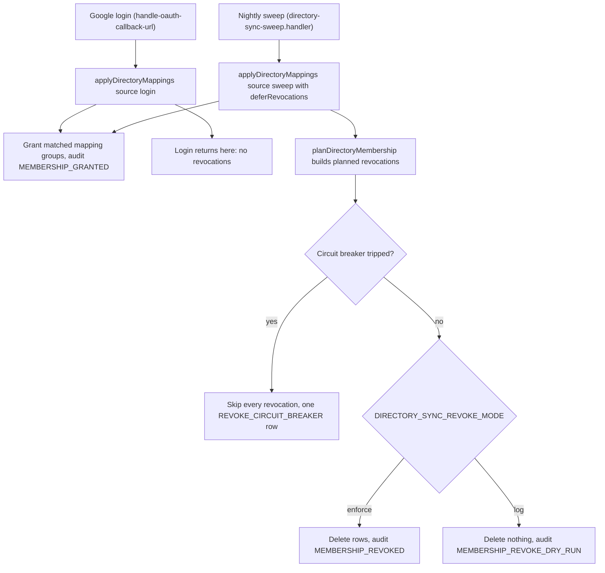

# Google SSO, auto-join, and directory sync

## Auto-join on sign-up

[`packages/lib/server-only/user/create-user.ts`](../../packages/lib/server-only/user/create-user.ts)
hardcodes three PSD401 constants: `PSD401_ORG_ID = 'org_psd401district'`,
`PSD401_MEMBER_GROUP_ID = 'org_group_psd401_member'`,
`PSD401_DEFAULT_TEAM_GROUP_ID = 'org_group_default_member'`.
`onCreateUserHook(user)` calls `addUserToPsd401Org(user.id)`, which:

- no-ops if the user already has an `OrganisationMember` row for
  `org_psd401district`;
- otherwise creates one `OrganisationMember` row with two nested
  `OrganisationGroupMember` creates: one for `org_group_psd401_member`
  (the org-wide member group) and one for `org_group_default_member` (the
  Default team's member group).

Both membership rows land on the *same* new user in the same hook call —
this is what lets a fresh Google sign-in both join the PSD401 org and get
into the Default team's document context in one step. If a directory-sync
or manual-provisioning path creates only the org-level membership without
the team-level one, the user can log in but has no team context to send
documents from (see `reference_known_issues` for the recurring
`org_member_auto_*` variant of this gap).

Sign-up is restricted by allowed email domain:
`getAllowedSignupDomains()` in
[`packages/lib/constants/auth.ts`](../../packages/lib/constants/auth.ts)
reads `NEXT_PRIVATE_ALLOWED_SIGNUP_DOMAINS` (comma-separated, lowercased,
trimmed); an empty value allows all domains. Production sets this to
`psd401.net`.

## Google Directory Sync

A nightly job re-syncs each user's Google Workspace attributes (`department`,
`orgUnitPath`, `googleGroups`) and, separately from the sync itself, an
apply engine grants org-group membership based on admin-managed mapping
rules — both gated behind `GOOGLE_DIRECTORY_SYNC_ENABLED=true`.

Caption: how the two triggers reach the same apply engine. Login can only grant;
revocation exists only on the sweep path.

- **Sweep job**: [`packages/lib/jobs/definitions/internal/directory-sync-sweep.ts`](../../packages/lib/jobs/definitions/internal/directory-sync-sweep.ts),
  cron `0 9 * * *` (09:00 UTC, ~1am Pacific), handler in
  [`directory-sync-sweep.handler.ts`](../../packages/lib/jobs/definitions/internal/directory-sync-sweep.handler.ts),
  which calls `applyDirectoryMappings(user.id, 'sweep', ..., { deferRevocations: true })`
  per user and then applies revocations under the circuit breaker.
- **Apply engine**: [`packages/lib/server-only/directory-sync/apply-directory-mappings.ts`](../../packages/lib/server-only/directory-sync/apply-directory-mappings.ts) —
  reads a user's synced `department`/`orgUnitPath`/`googleGroups` and all
  `active: true` `DirectoryGroupMapping` rows, matches via
  [`mapping-matching.ts`](../../packages/lib/server-only/directory-sync/mapping-matching.ts),
  and inserts any missing `OrganisationGroupMember` rows. Each grant writes a
  `DirectorySyncAuditLog` row (`type: MEMBERSHIP_GRANTED`). Login only grants.
  The nightly sweep also plans revocations: rows in groups an active mapping
  targets that the user no longer matches. `DIRECTORY_SYNC_REVOKE_MODE`
  (`enforce` / `log` / `off`, default `log`) decides whether they are deleted
  or only audited as `MEMBERSHIP_REVOKE_DRY_RUN`. The sweep's circuit breaker
  skips every revocation (one `REVOKE_CIRCUIT_BREAKER` row) when planned
  revocations exceed both 10 and 5%, org-wide or within one group.
- **Admin groups are off limits**: a mapping whose target group has
  organisation role ADMIN or any `TeamGroup.teamRole` ADMIN never grants or
  revokes. The planner skips these mappings through `groupGrantsAdmin` in
  [`plan-directory-membership.ts`](../../packages/lib/server-only/directory-sync/plan-directory-membership.ts),
  and the sweep's Prisma filter `ADMIN_GRANTING_GROUP_WHERE` (in
  [`assert-mapping-target-allowed.ts`](../../packages/lib/server-only/directory-sync/assert-mapping-target-allowed.ts))
  excludes these groups from managed-membership counts. The create and update
  mapping paths call `assertMappingTargetAllowed` (update only when the mapping
  stays active), so they reject such a target.
  The reverse also holds: `assertGroupsNotDirectoryMapped` rejects giving a
  mapped group ADMIN. It runs in
  [`update-organisation-group.ts`](../../packages/trpc/server/organisation-router/update-organisation-group.ts)
  when the org role becomes ADMIN, and in
  [`create-team-groups.ts`](../../packages/trpc/server/team-router/create-team-groups.ts)
  and [`update-team-group.ts`](../../packages/trpc/server/team-router/update-team-group.ts)
  when a team role becomes ADMIN. The sweep logs an error naming any active
  mapping it ignores for this reason (`reportIgnoredAdminMappings` in
  `directory-sync-sweep.handler.ts`, only when the sync flag is on).
- **Matching rules** (`DirectoryMappingSourceField` enum:
  `GROUP | DEPARTMENT | ORG_UNIT`): `GROUP` does a case-insensitive match
  against the user's Google group list; `DEPARTMENT` is an exact string
  match; `ORG_UNIT` is a prefix/path match on the normalized
  `orgUnitPath` (`/` matches everyone).

### What a mapping actually grants — correcting a common shorthand

A `DirectoryGroupMapping` row (schema.prisma, `DirectoryGroupMapping`
model) has FK `organisationGroupId → OrganisationGroup`, **not** a direct
FK to `Team`. A mapping grants membership in an `OrganisationGroup`; that
group only translates into team access if it's separately linked to a
team via a `TeamGroup` row (`organisationGroupId` + `teamId` +
`teamRole`). So "map a Google attribute to a team" is a two-step
relationship in the schema: attribute → `OrganisationGroup` (via the
mapping) → `Team` (via a pre-existing `TeamGroup` link) — not a mapping
directly onto a team. This matters when troubleshooting: creating a
mapping to a group that isn't linked to any team via `TeamGroup` grants
org membership but no team/document access.

### Admin UI

`admin.directoryMappings` tRPC namespace: `create-directory-mapping.ts`,
`update-directory-mapping.ts`, `delete-directory-mapping.ts`,
`find-directory-mappings.ts` and `list-directory-mapping-groups.ts` (group
picker) under `packages/trpc/server/admin-router/` (start with
[`create-directory-mapping.ts`](../../packages/trpc/server/admin-router/create-directory-mapping.ts)). UI route:
[`apps/remix/app/routes/_authenticated+/admin+/directory-mappings.tsx`](../../apps/remix/app/routes/_authenticated+/admin+/directory-mappings.tsx).

### Schema

Migration
[`packages/prisma/migrations/20260812000000_add_directory_group_mapping/migration.sql`](../../packages/prisma/migrations/20260812000000_add_directory_group_mapping/migration.sql)
added: enum `DirectoryMappingSourceField` (`GROUP`, `DEPARTMENT`,
`ORG_UNIT`); table `DirectoryGroupMapping` (`sourceField`, `sourceValue`,
`organisationGroupId`, `active`, unique on
`(sourceField, sourceValue, organisationGroupId)`); table
`DirectorySyncAuditLog` (`type`, `data` JSON, optional `userId`/`name`/
`email`, indexed on `createdAt`/`type`).

Design docs: [`docs/superpowers/plans/2026-05-19-google-directory-sync.md`](../../docs/superpowers/plans/2026-05-19-google-directory-sync.md)
(Phase 1: sync), [`docs/superpowers/plans/2026-08-12-directory-sync-phase2.md`](../../docs/superpowers/plans/2026-08-12-directory-sync-phase2.md)
(Phase 2: mapping + apply engine. Its additive-only invariant was replaced by sweep revocation in PR #172).

## Change guidance

- Start with `applyDirectoryMappings` in
  [`apply-directory-mappings.ts`](../../packages/lib/server-only/directory-sync/apply-directory-mappings.ts)
  for any grant or revoke change, and with `planDirectoryMembership` in
  [`plan-directory-membership.ts`](../../packages/lib/server-only/directory-sync/plan-directory-membership.ts)
  for matching or circuit-breaker logic. The planner is pure (no Prisma).
- Invariants to keep: login never revokes; no directory-mapped path confers
  ADMIN; a mapping whose target grants ADMIN is inert, never managed.
- Focused tests: `apply-directory-mappings.test.ts` (login versus sweep,
  "does not grant a matched mapping whose target group grants admin"),
  `plan-directory-membership.test.ts` (`groupGrantsAdmin`, circuit breaker),
  `assert-mapping-target-allowed.test.ts`, `create-directory-mapping.test.ts`
  and `update-directory-mapping.test.ts` (admin-target rejection), and
  `directory-sync-sweep.handler.test.ts`. Run them with
  `cd packages/lib && npx vitest run --project unit server-only/directory-sync`.
- Not covered by a shared test: the tRPC guards in the organisation and team
  routers. Check those routes directly if you change `assertGroupsNotDirectoryMapped`
  callers.

## Source references

- [`packages/lib/server-only/user/create-user.ts`](../../packages/lib/server-only/user/create-user.ts)
- [`packages/lib/server-only/directory-sync/apply-directory-mappings.ts`](../../packages/lib/server-only/directory-sync/apply-directory-mappings.ts) and [`plan-directory-membership.ts`](../../packages/lib/server-only/directory-sync/plan-directory-membership.ts) (apply, matching, CRUD)
- [`packages/lib/jobs/definitions/internal/directory-sync-sweep.ts`](../../packages/lib/jobs/definitions/internal/directory-sync-sweep.ts)
- [`packages/trpc/server/admin-router/create-directory-mapping.ts`](../../packages/trpc/server/admin-router/create-directory-mapping.ts) and the other `*directory-mapping*.ts` files beside it
- [`packages/trpc/server/organisation-router/update-organisation-group.ts`](../../packages/trpc/server/organisation-router/update-organisation-group.ts), [`team-router/create-team-groups.ts`](../../packages/trpc/server/team-router/create-team-groups.ts), [`team-router/update-team-group.ts`](../../packages/trpc/server/team-router/update-team-group.ts) (ADMIN guards)
