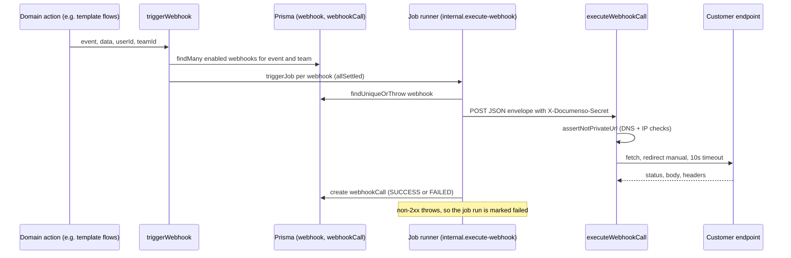

# Outbound webhooks and the removed inbound trigger route

Documenso sends webhook events to customer-registered URLs when envelopes,
templates, and signing flows change. Dispatch is **in-process**: domain code
calls `triggerWebhook()`, which enqueues one background job per matching
webhook, and the job runner performs the HTTP call. There is no inbound
"trigger a webhook" endpoint; the one that existed was deleted in
commit `c46facb3c` (PR #201).

## Dispatch path

`triggerWebhook()` in
[`packages/lib/server-only/webhooks/trigger/trigger-webhook.ts`](../../packages/lib/server-only/webhooks/trigger/trigger-webhook.ts)
is called from domain code such as the template flows
(`create-document-from-template.ts`, `create-document-from-direct-template.ts`,
`delete-template.ts`) and the eIDAS/CSC signing path
(`packages/ee/server-only/signing/csc/execute-tsp-sign.ts`). It:

1. Selects registrations with `getAllWebhooksByEventTrigger()` (enabled,
   `eventTriggers` contains the event, team visible to `userId`/`teamId`).
2. Calls `jobs.triggerJob({ name: 'internal.execute-webhook', ... })` once per
   webhook, with `Promise.allSettled`, so one bad registration does not block
   the others. Errors from the lookup or enqueue step are logged and rethrown
   as `Failed to trigger webhook`.

The template flows call `triggerWebhook()` after their database transaction
commits ("outside the transaction to avoid holding the connection open during
network I/O"), and await both calls with `Promise.allSettled`.

The job runner then executes the job defined in
[`execute-webhook.ts`](../../packages/lib/jobs/definitions/internal/execute-webhook.ts).
Its handler, [`execute-webhook.handler.ts`](../../packages/lib/jobs/definitions/internal/execute-webhook.handler.ts),
is lazy-imported at run time (see [jobs and PDF pipeline](../architecture/jobs-and-pdf-pipeline.md)
for the job system itself). Job mechanics are owned there; this page only
covers what the webhook job does.

*Caption: a webhook event is queued by the domain action and delivered by the
job runner, which records every attempt in `webhookCall`.*

### Payload and delivery contract

- The POST body is `{ event, payload, createdAt, webhookEndpoint }`. The
  `payload` is the domain data passed to `triggerWebhook()`.
- The shared secret is sent as the `X-Documenso-Secret` header value. No
  HMAC signature is computed in this path. Receivers must compare that header
  against the secret they registered.
- Calls use `redirect: 'manual'` and a 10 second timeout
  (`WEBHOOK_TIMEOUT_MS` in `execute-webhook-call.ts`). Non-2xx responses and
  network errors are stored as `FAILED` calls, and the job run then throws so
  the job runner records the failure.

### SSRF guard

`executeWebhookCall()` calls `assertNotPrivateUrl()` before every request
([`assert-webhook-url.ts`](../../packages/lib/server-only/webhooks/assert-webhook-url.ts)).
It rejects localhost and private addresses, resolves hostnames with a 250 ms
DNS timeout, and rejects the URL if any resolved address is private. The
bypass list comes from `NEXT_PRIVATE_WEBHOOK_SSRF_BYPASS_HOSTS` (read once at
module load; empty means no bypass). `is-private-url.ts` holds the address
classification.

## Resend

`resendWebhookCallRoute` in
[`resend-webhook-call.ts`](../../packages/trpc/server/webhook-router/resend-webhook-call.ts)
re-enqueues a stored delivery. It reads the original envelope from
`webhookCall.requestBody`, unwraps `payload` with `ZWebhookPayloadSchema`, and
queues `internal.execute-webhook` again. The lookup requires team
`MANAGE_TEAM` permission, so a resend is a new `WebhookCall` row, not an edit
of the old one.

## Removed inbound route: `/api/webhook/trigger`

The Remix route `apps/remix/app/routes/api+/webhook.trigger.ts`, its
`packages/lib/server-only/webhooks/trigger/handler.ts`, and `schema.ts` were
deleted in `c46facb3c`. The route was marked for deletion upstream, had no
caller (webhooks are queued in-process as above), and was protected only by a
signature keyed on `NEXT_PRIVATE_ENCRYPTION_KEY`, so it was an extra entry
point for anyone holding that key.

Guards for this decision:

- `packages/lib/utils/webhook-trigger-route-removed.test.ts` asserts that the
  route and handler files do not exist and that `stripe.webhook.ts` does not
  reference `webhook.trigger`.
- `apps/remix/app/routes/api+/stripe.webhook.ts` now types its `Route` from
  its own generated `./+types/stripe.webhook`. It is the only webhook
  receiver left under `api+/`; it is a Stripe billing receiver owned by the
  enterprise package, not an outbound-webhook path.

[operations/deployment.md](../operations/deployment.md) documents the key
rotation that followed the same security review.

## Change guidance

- **Adding a new event type**: extend the `WebhookTriggerEvents` enum in
  `packages/prisma/schema.prisma`, call `triggerWebhook()` from the domain
  action after the state change commits, and pass the team and user the action
  runs for. Do not call the job runner directly.
- **Changing delivery semantics** (timeouts, headers, retries): edit
  `executeWebhookCall()` and the handler together; the handler owns the
  `WebhookCall` audit row and the job failure.
- **Changing SSRF behaviour**: edit `assert-webhook-url.ts` and run its tests.
  Do not widen `NEXT_PRIVATE_WEBHOOK_SSRF_BYPASS_HOSTS` defaults.
- Focused check: `cd packages/lib && npx vitest run server-only/webhooks utils/webhook-trigger-route-removed`
  (the vitest config lives in `packages/lib/vitest.config.ts`).
- Not needed for these changes: the full E2E suite or Docker image build,
  unless the change touches the job runner itself
  ([jobs and PDF pipeline](../architecture/jobs-and-pdf-pipeline.md)).

Related: [Public API v2 and n8n](api-and-n8n.md) describes the inbound API
that external callers use, which is separate from these outbound events.
