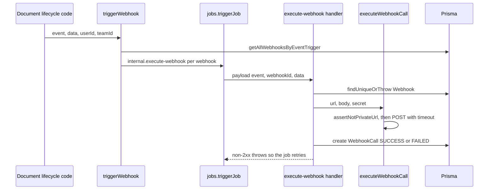

# Outbound webhooks

Documenso lets a team register webhook endpoints that receive JSON when
document lifecycle events happen. Event producers and delivery are both
in-process: domain code calls `triggerWebhook()`, which enqueues one job per
matching webhook, and a job later POSTs the payload. Nothing outside the
server can start a fan-out.

## Dispatch path

[`triggerWebhook()`](../../packages/lib/server-only/webhooks/trigger/trigger-webhook.ts)
takes `{ event, data, userId, teamId }`, loads matching webhooks with
`getAllWebhooksByEventTrigger()`, and calls `jobs.triggerJob()` with the
`internal.execute-webhook` job name for each one. It returns early when no
webhook is registered. Failures are logged and rethrown as
`Failed to trigger webhook`.

Callers are document and template flows, for example
`send-document.ts`, `complete-document-with-token.ts`, `cancel-document.ts`,
`delete-document.ts`, `duplicate-envelope.ts`, and the seal and reminder
jobs under `packages/lib/jobs/definitions/internal/`. Those callers are the
reason webhook behavior is coupled to the document lifecycle; see
[Background jobs and PDF pipeline](../architecture/jobs-and-pdf-pipeline.md)
for how the queued job is run.

Caption: a document event fans out to one queued job per registered webhook; each job makes one HTTP attempt and records it.

## Delivery contract

- The job definition is
  [`EXECUTE_WEBHOOK_JOB_DEFINITION`](../../packages/lib/jobs/definitions/internal/execute-webhook.ts)
  with payload `{ event, webhookId, data, requestMetadata? }`. Its handler
  is lazy-imported from `execute-webhook.handler.ts` and exported as `run`.
- The POST body is `{ event, payload, createdAt, webhookEndpoint }`. Requests
  use `Content-Type: application/json` and an `X-Documenso-Secret` header
  set to the webhook's stored secret (empty string when none is set).
- [`executeWebhookCall()`](../../packages/lib/server-only/webhooks/execute-webhook-call.ts)
  uses `redirect: 'manual'` and a 10-second timeout. Network errors are
  caught and returned as `responseCode: 0`, not thrown.
- `run()` always writes a `WebhookCall` row. A non-2xx response then throws
  `Webhook execution failed with status <code>`, so the job runner's retry
  policy applies. The retry settings belong to the job system, not this page.

## Destination safety (SSRF guard)

[`assertNotPrivateUrl()`](../../packages/lib/server-only/webhooks/assert-webhook-url.ts)
runs before each request. It rejects localhost and private IP literals
immediately, then resolves the hostname and rejects if any resolved address
is private. Hosts listed in `NEXT_PRIVATE_WEBHOOK_SSRF_BYPASS_HOSTS` are
exempt; the list is empty by default. The DNS lookup has a 250 ms cap, and
the tests pin the current behavior that a DNS failure or timeout is allowed
through. Treat that as a deliberate tradeoff when changing the guard;
`is-private-url.ts` holds the address classification.

## Management API

[`webhookRouter`](../../packages/trpc/server/webhook-router/router.ts) is an
`authenticatedProcedure` router with `getTeamWebhooks`, `getWebhookById`,
`createWebhook`, `deleteWebhook`, `editWebhook`, `testWebhook`, plus
`find-webhook-calls.ts` for delivery history and `resend-webhook-call.ts`,
which re-enqueues `internal.execute-webhook` for an existing call. Browser
clients reach these procedures through the internal tRPC API; they are not
part of the public v2 API described in
[Public API v2 and n8n](api-and-n8n.md).

## Removed inbound route: `/api/webhook/trigger`

Earlier revisions exposed a Remix route that accepted a signed JSON body and
queued the same webhook jobs from outside the process. Commit `c46facb3c`
(PR #201) removed the route, its handler (`handlerTriggerWebhooks`), and its
schema. The removal's stated reason was that nothing called it, and its only
check was a signature derived from `NEXT_PRIVATE_ENCRYPTION_KEY`, which made
it an extra entry point for anyone holding that key. Webhooks are now queued
only by `triggerWebhook()`.

The guard test
[`webhook-trigger-route-removed.test.ts`](../../packages/lib/utils/webhook-trigger-route-removed.test.ts)
fails if the route module or handler file comes back, or if the Stripe
route re-imports the removed `webhook.trigger` types. The Stripe endpoint
`apps/remix/app/routes/api+/stripe.webhook.ts` is a separate inbound handler
(`stripeWebhookHandler`) for billing events and is unaffected.

## Change guidance

- To add a lifecycle event, add the enum value and call `triggerWebhook()` at
  the point where the state change is committed. Do not add a new HTTP entry
  point for fan-out; the removed route shows why that was rejected.
- Changes to the POST body or headers are a consumer-facing contract; keep the
  `event`/`payload`/`createdAt`/`webhookEndpoint` shape stable.
- Changes to `assertNotPrivateUrl` need the `assert-webhook-url.test.ts`
  cases for literal IPs, DNS resolution, and DNS failure to be re-checked.
- Narrow check: `npm run test -w @documenso/lib -- webhook` runs the webhook
  unit tests and the removal guard. Use `npx tsc --noEmit -p packages/lib/tsconfig.json`
  for type-only changes. Neither needs a full build.
