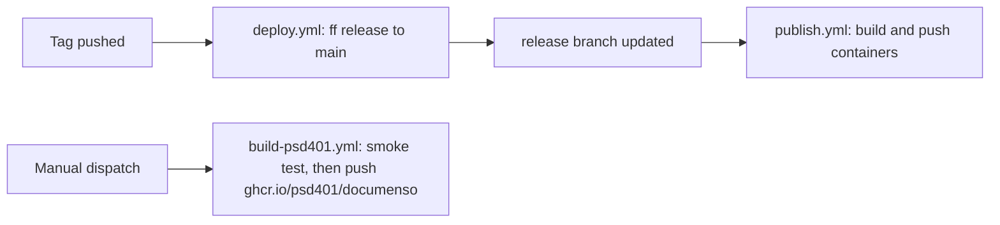

# CI, security scanning, and release workflows

This fork's automation is split between workflows in this repository and
reusable workflows owned by the PSD401 organisation in `PSD401/.github`.
The repository files only pin and call them, so the scanning logic itself
is not inspectable here. This page covers the in-repo half and the release
chain that [Deployment](deployment.md) depends on.

## Workflow inventory

| Workflow | Triggers | What it does |
|---|---|---|
| [`ci.yml`](../../.github/workflows/ci.yml) | push and PR to `main`; `workflow_call` | `build_app` builds the app; `build_docker` builds `docker/Dockerfile` and runs the document-conversion smoke test. |
| [`e2e-tests.yml`](../../.github/workflows/e2e-tests.yml) | push and PR to `main` | Playwright end-to-end suite on a larger runner. |
| [`security-scan.yml`](../../.github/workflows/security-scan.yml) | PR, push to `main`, Mondays 09:00 UTC, manual | Calls the org reusable scan. Per the pinning commit message, it runs zizmor at high severity and gitleaks over full history. |
| [`claude-review.yml`](../../.github/workflows/claude-review.yml) | PR opened, synchronized, reopened, or ready for review | Calls the org Claude review reusable. Dependabot PRs go to a no-op job named `claude-review`, so the required check still reports. |
| [`openwiki-update.yml`](../../.github/workflows/openwiki-update.yml) | push to `main`, Mondays 08:00 UTC, manual | Calls the org OpenWiki reusable that regenerates `openwiki/`. Concurrency group `openwiki` cancels superseded runs. |
| [`deploy.yml`](../../.github/workflows/deploy.yml) | push of any tag | Fast-forwards the `release` branch to `main`. |
| [`publish.yml`](../../.github/workflows/publish.yml) | push to `release`; manual with a tag input | Builds and pushes platform containers and manifests. See the naming caveat below. |
| [`build-psd401.yml`](../../.github/workflows/build-psd401.yml) | manual only | Builds the fork image and pushes `ghcr.io/psd401/documenso` after the smoke test. |
| `codeql-analysis.yml` | push and PR to `main`; manual | CodeQL analysis. |
| `translations-*.yml` | scheduled or manual | Crowdin sync. `translations-pull.yml` has its job disabled with `if: false`. |

## Release chain

Caption: tag pushes feed the upstream-style publish path; PSD401 images come from the manual dispatch path.

Two image paths exist. `publish.yml` tags images under the
`ghcr.io/documenso/documenso-*` namespace, which is upstream's naming and
not the PSD401 registry. Confirm the target before relying on that workflow
for district images. The image the district runs is built by
`build-psd401.yml` and described in [Deployment](deployment.md).

## Build smoke test

`ci.yml`'s `build_docker` job builds `docker/Dockerfile` with the
`documenso-${{ github.sha }}` tag and runs three `docker run` checks:
`command -v soffice`, `command -v qpdf`, and `fc-list | grep -iq liberation`.
`build-psd401.yml` runs the same three checks before pushing either tag.
The checks guard the DOCX conversion and encrypted-PDF paths described in
[Background jobs and PDF pipeline](../architecture/jobs-and-pdf-pipeline.md).

## Action pinning

Commit `26176342f` pinned every external `uses:` to a full commit SHA, with
the resolved tag in a trailing comment, after zizmor reported high-severity
unpinned-uses findings. Local composite actions in
[`.github/actions/node-install/action.yml`](../../.github/actions/node-install/action.yml)
and `playwright-install` are referenced by path and are not pinned.

Organisation reusables are pinned to `PSD401/.github` at commit
`1aa5f535…` (`# v1.0.0`) in `security-scan.yml`, `claude-review.yml`, and
`openwiki-update.yml`. Callers must grant what the reusable needs:
`openwiki-update.yml` sets `contents: write` and `pull-requests: write`, and
`claude-review.yml` sets `id-token: write`. The org default token is
read-only, and a reusable cannot elevate its caller. Dependabot-triggered
runs cannot receive `id-token: write`, which is why the Claude review job is
skipped for `dependabot[bot]`.

Only the two secrets each reusable uses are passed explicitly
(`BEDROCK_API_KEY` and `PSD_AUTOMATION_APP_PRIVATE_KEY` for OpenWiki, and
`BEDROCK_API_KEY` for Claude review). Do not reintroduce `secrets: inherit`.

## Secret-scan policy (`.gitleaksignore`)

`.gitleaksignore` records reviewed gitleaks findings. gitleaks reads it by
default. Each line is `<commit>:<file>:<rule>:<line>`, so a new finding
anywhere else still fails `security-scan`. The file was added in commit
`26176342f` with these groups, according to that commit message:

- About 50 entries in upstream `documenso/documenso` history: example tokens,
  keys, and auth headers in public docs, blog content, and a patch file.
- Four PSD-only entries: `NEXT_PRIVATE_ENCRYPTION_KEY` and
  `NEXT_PRIVATE_ENCRYPTION_SECONDARY_KEY` in `deploy/docker-compose.dev.yml`.
  The commit message says acceptance assumes production uses different keys,
  which it notes was not verified there. The same file's rotation note is in
  [Deployment](deployment.md).

Do not extend the file to silence a new finding without the same review
note. Add a comment explaining the upstream or PSD-only origin.

## Validation

- Workflow edits: the repo has no workflow test script. The commit messages
  for `26176342f` and `c46facb3c` record zizmor 1.6.0 with
  `--min-severity high` and gitleaks 8.24.0 with the org config as the
  checks used. Those tools are external and not in `package.json`.
- Changing a SHA pin: confirm the new SHA matches the tag and that the
  workflow still parses. Do not hand-edit a reusable's pinned commit without
  reviewing the upstream `PSD401/.github` change first.
- Dockerfile or runtime-dependency changes: the `build_docker` smoke test is
  the relevant check. It is expensive (a full image build), so run it through
  CI rather than locally unless the Dockerfile itself changed.
