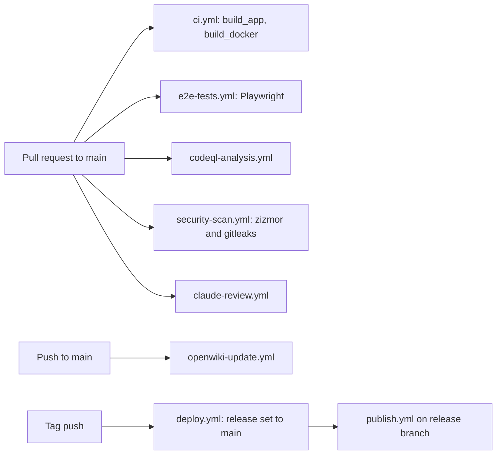

# CI, security scanning, and automation workflows

<!-- openwiki: broken internal link [../../.github/workflows] file "../../.github/workflows" does not exist. Fix the href or restore the target, then delete this comment. -->
All automation lives in [`.github/workflows/`](../../.github/workflows). The
security gates, the review gate, the OpenWiki job, and the image and release
jobs feed [deployment](deployment.md); the org-owned reusable workflows they
call live in `PSD401/.github`, outside this repository. Read this page before
changing any workflow file, adding an external `uses:` line, or adding a
value that a secret scanner would flag.

## Workflow map

| Concern | Workflow file | Trigger | What it does |
|---|---|---|---|
| Build and Docker smoke test | [`ci.yml`](../../.github/workflows/ci.yml) | push and PR to `main`, `workflow_call` | `build_app` runs `npm run build`. `build_docker` builds `docker/Dockerfile` without pushing, then runs the three-command runtime check described below. |
| E2E | [`e2e-tests.yml`](../../.github/workflows/e2e-tests.yml) | push and PR to `main` | Starts services with `npm run dx:up`, migrates, seeds, installs Playwright, runs `npm run ci`. |
| Static analysis | [`codeql-analysis.yml`](../../.github/workflows/codeql-analysis.yml) | push and PR to `main`, dispatch | CodeQL, `javascript` language. |
| Security scan | [`security-scan.yml`](../../.github/workflows/security-scan.yml) | PR, push to `main`, weekly cron (Mon 09:00 UTC), dispatch | Calls the org reusable `PSD401/.github` `reusable-security-scan.yml`. |
| Review gate | [`claude-review.yml`](../../.github/workflows/claude-review.yml) | PR opened, synchronize, ready, reopened | Calls the org reusable `reusable-claude-review.yml`. |
| Wiki refresh | [`openwiki-update.yml`](../../.github/workflows/openwiki-update.yml) | dispatch, push to `main`, weekly cron (Mon 08:00 UTC) | Calls the org reusable `reusable-openwiki.yml`. |
| Image build | [`build-psd401.yml`](../../.github/workflows/build-psd401.yml) | dispatch only | Builds and pushes `ghcr.io/psd401/documenso` after the smoke test. |
| Release | [`deploy.yml`](../../.github/workflows/deploy.yml), [`publish.yml`](../../.github/workflows/publish.yml) | tag push (`deploy.yml`), push to `release` or dispatch with a tag (`publish.yml`) | `deploy.yml` fast-forwards `release` to `main`. `publish.yml` builds and publishes platform containers. |
| Housekeeping | labelers, stale, first-interaction, semantic PR title, translations | various | Upstream automation for labels, stale issues, and Crowdin sync. |



## Docker smoke test (shared with image builds)

`build_docker` in `ci.yml` and the `build-psd401.yml` build both run the same
three checks against the built image, before anything is pushed:

```bash
docker run --rm "$IMAGE" sh -c 'command -v soffice'
docker run --rm "$IMAGE" sh -c 'command -v qpdf'
docker run --rm "$IMAGE" sh -c 'fc-list | grep -iq liberation'
```

These guard against a runtime image that cannot convert DOCX/DOC uploads or
decrypt encrypted PDFs. The binaries are resolved via `which` by
`convert-to-pdf.ts` and `decrypt-pdf.ts`; see
[jobs-and-pdf-pipeline.md](../architecture/jobs-and-pdf-pipeline.md). If you
add a runtime dependency to `docker/Dockerfile`, extend these checks in both
places.

## Action pinning policy

Every external `uses:` is pinned to a full commit SHA with the resolved tag in
a trailing comment, for example
`actions/checkout@11d5960a… # v4.4.0`. This was done so that the org security
scan's zizmor check (`unpinned-uses`, high severity) passes. Two exceptions
are intentional:

- Local composite actions under `.github/actions/` (`node-install`,
  `playwright-install`) are referenced by path.
- Org reusable workflows from `PSD401/.github` are pinned to `@main` on
  purpose, so central bumps propagate. Their lines carry
  `# zizmor: ignore[unpinned-uses]`. Keep that comment when editing them.

When adding an external action, pin it to a SHA and keep the tag comment.
`github-script@v6`, `labeler@v4`, and `stale@v5` were noted as Node 16-era and
pending a separate bump.

## Security scan and secret findings

`security-scan.yml` delegates to the org reusable. Per the commit that
introduced it (`26176342f`), that reusable runs zizmor at `--min-severity high`
and then gitleaks over full git history. The reusable itself is not in this
repository, so its exact rules are not verifiable here.

The repo intentionally has no `.gitleaks.toml`, so the org's default config
applies. `.gitleaksignore` records reviewed historical findings. Each entry is
a fingerprint of the form `<commit>:<file>:<rule>:<line>`, and any new finding
still fails the check.

- Most entries are example tokens, keys, and auth headers in upstream
  Documenso's public docs and blog. These commits are in upstream history.
- Four entries are PSD-only: the `NEXT_PRIVATE_ENCRYPTION_KEY` and
  `NEXT_PRIVATE_ENCRYPTION_SECONDARY_KEY` values in
  `deploy/docker-compose.dev.yml`. Accepting them assumes production uses
  different keys. That assumption is not verified by the repo. The keys were
  rotated on 2026-10-12 (see [deployment.md](deployment.md) and
  [fork changes](../fork/changes.md)).

Do not add a suppression to `.gitleaksignore` for a new finding. Remove the
secret or rotate it, then fix the file. Edits to `deploy/docker-compose.dev.yml`
or the docs that quote secret-shaped values can produce new findings.

## Claude review gate

`claude-review.yml` skips Dependabot for the real review job, which is the
one that calls the org reusable with `BEDROCK_API_KEY` and `id-token: write`.
A second job, `claude-review-dependabot`, has the same display name
(`claude-review`) and calls a no-op reusable. This is required because
production repos require a `claude-review / claude-review` status check, and
a skipped job would leave that context unreported. If you rename either job,
check the branch protection rule.

## OpenWiki update job

`openwiki-update.yml` passes only the two secrets it uses,
`BEDROCK_API_KEY` and `PSD_AUTOMATION_APP_PRIVATE_KEY`, rather than
`secrets: inherit` (commit `5bf50013c`). It grants `contents: write` and
`pull-requests: write`, runs with `concurrency: openwiki` and
`cancel-in-progress: true`, and opens pull requests with `auto_merge: false`.
Its output is this `openwiki/` tree.

## Validation

- Workflow edits have no unit tests. Confirm no external action is still pinned
  by tag with `grep -rnE "uses: [^./]+@v[0-9]" .github/workflows` (expect no
  output; reusable `@main` lines are excluded by the pattern). Then run
  `actionlint`, which the pinning commit used.
- Changes to `.gitleaksignore`, or new secret-shaped text, are conditional
  checks: run the gitleaks 8.24.0 git scan with the org config, as in
  `26176342f`. A full-history scan is slow, so run it only when those files
  change.
- The Docker smoke test is the only runtime-image check. Run its three commands
  against a locally built image when you change `docker/Dockerfile` runtime
  packages.

## Scope boundaries

- The org reusable workflows, their rules, and the `PSD401/.github` repo are
  outside this repository. Document them only as external dependencies.
- Generic housekeeping workflows (labelers, stale, Crowdin, first-interaction)
  are not PSD-specific. Do not expand this page to cover them.
st-interaction)
  are not PSD-specific. Do not expand this page to cover them.
